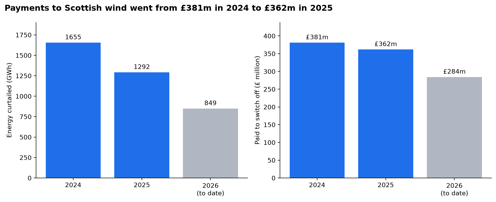
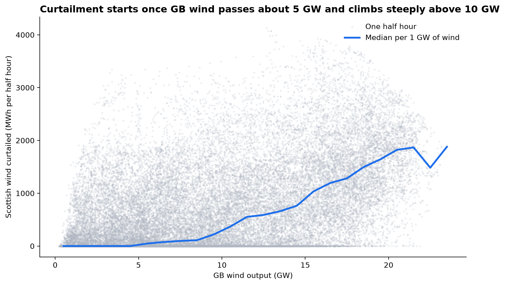
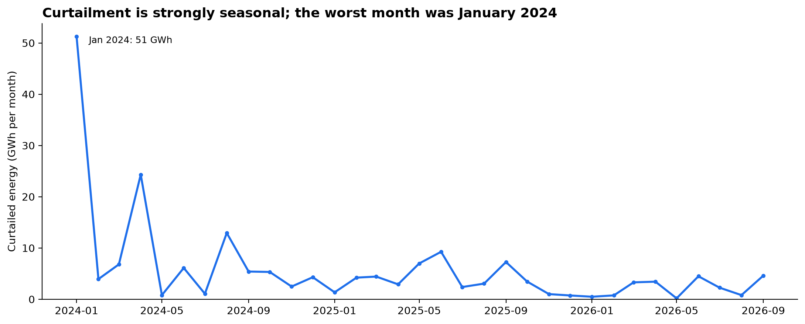
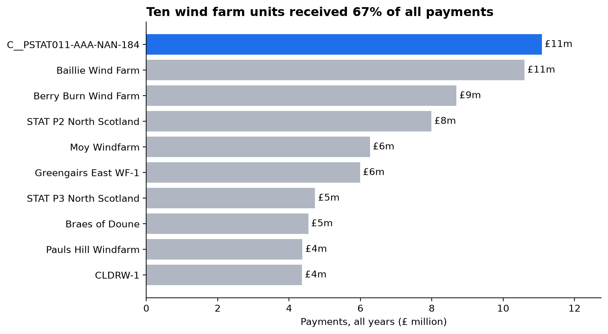
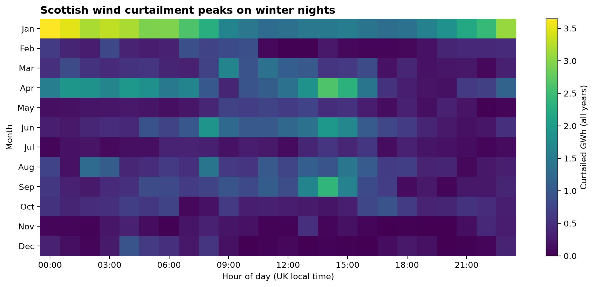

# Scottish Wind Curtailment: How Much Do We Pay to Switch Off the Wind?

**Between January 2024 and October 2026, Scottish wind farms were paid £1.03bn to switch off 28.9 TWh of electricity that the grid couldn't carry south. The amount of wind being switched off is rising fast, but the bill isn't, because the farms being curtailed are increasingly the cheap ones.**



I built this project to put my own numbers on one of the biggest issues in the GB electricity system right now. On windy days, Scotland generates more power than the transmission network can carry to where the demand is, so the system operator pays wind farms to stop generating. Rather than relying on headline figures from the news, I wanted to rebuild them from the raw settlement data myself and work out when it happens, which farms are affected, and how it's changing.

## Key findings

| Year | Energy curtailed | Paid to switch off | Average price | Units curtailed |
| --- | --- | --- | --- | --- |
| 2024 | 8,242 GWh | £381.0m | £46.2/MWh | 126 |
| 2025 | 10,068 GWh | £361.8m | £35.9/MWh | 130 |
| 2026 (to 28 Oct) | 10,616 GWh | £284.2m | £26.8/MWh | 135 |

- **Curtailment is growing fast.** 2026 had already passed the whole of 2025 by the end of October. Comparing January to September each year, the energy curtailed rose 74%, from 5,034 GWh in 2024 to 8,740 GWh in 2026.
- **The bill isn't growing with it.** Over the same January to September window, payments fell 9%, from £254.7m to £232.1m.
- **That's because the average price is falling**, from £46/MWh in 2024 to £27/MWh in 2026. The most likely reason is that more of the curtailment now falls on large offshore farms with Contracts for Difference, such as Moray East and Seagreen, which bid close to zero. On a sample day in January 2025 they were paid about £1–2/MWh, compared with the much higher bids typical of older onshore farms.
- **The worst months are recent and in the windy season.** The top five were October 2026 (1,876 GWh, and that's with data only to the 28th), September 2026 (1,816 GWh), March 2026 (1,471 GWh), December 2024 (1,358 GWh) and October 2025 (1,282 GWh).
- **Payments are concentrated.** The ten most-paid units received 37% of all payments.
- **There's a clear threshold.** Typical curtailment starts to lift once GB wind output passes about 5 GW, climbs steeply above about 10 GW, and levels off at around 1,800–1,900 MWh per half hour (roughly 3.7 GW switched off) when GB wind is above 20 GW.



## Why it happens

Most of GB's wind capacity is in Scotland, but most of the demand is in England. The transmission lines between them have a hard limit, with the tightest bottlenecks at the B4 boundary in northern Scotland and the B6 boundary at the Scotland–England border. When those lines are full, NESO (the system operator) uses the Balancing Mechanism to fix it:

1. It **accepts bids** from Scottish wind farms, paying them to reduce output. A farm's bid price reflects the subsidy income it gives up by not generating, which is why older farms on Renewables Obligation certificates cost much more to switch off than newer CfD farms.
2. It **accepts offers** from generators south of the constraint, mostly gas in England, to replace the lost energy.

This project measures part 1: the direct payments to Scottish wind farms. The cost of replacement energy in part 2 is separate and isn't included here.

## Data and method

All data comes from Elexon's free [Insights Solution API](https://developer.data.elexon.co.uk/) (no API key needed), covering **1 January 2024 to 28 October 2026**.

| Data | Endpoint | Used for |
| --- | --- | --- |
| BM Unit reference data | `/reference/bmunits/all` | Identifying Scottish wind farms |
| Accepted bid volumes (DISPTAV) | `/balancing/settlement/indicative/volumes/all/bid/{date}` | MWh curtailed per unit per half hour |
| Bid cashflows (EBOCF) | `/balancing/settlement/indicative/cashflows/all/bid/{date}` | £ paid per unit per half hour |
| Acceptance volumes (BOAV) | `/balancing/settlement/acceptance/volumes/all/bid/{date}` | Checking which volume figure is correct |
| Wind and solar outturn (AGWS) | `/generation/actual/per-type/wind-and-solar` | GB wind output for the threshold analysis |

**Processing steps:**

1. Download one file per day for every BM Unit and cache it, so re-runs only fetch new days.
2. Build a list of Scottish wind units (see below). The final list has 167 units.
3. Filter each daily file down to those units, then join volumes to cashflows on unit, settlement date and settlement period.
4. Convert to UK local time using the period start time rather than the settlement period number, which handles the 46- and 50-period clock-change days correctly.

### Two things I got wrong at first

My first run gave £48m and 125 GWh for 2024, against published figures of around £385m and 8 TWh. Tracking down why was the most useful part of the project:

- **Most Scottish wind farms were missing.** I'd filtered on Elexon's GSP group to find units in Scotland, but transmission-connected units (the big ones, like Seagreen, Moray East and Viking) don't have a GSP group at all, so only 50 smaller units got through. I fixed this using each unit's transmission loss factor, which is set by geographic zone: every unmatched wind unit sharing a loss factor with known North or South Scotland units turned out to have a Scottish name, and every other value was English or Welsh. I checked the edge cases by hand (for example, Sofia on Dogger Bank has a value close to South Scotland's but lands at Teesside). The classification for all 187 transmission-connected wind units is in `data/processed/manual_overrides.csv`.
- **I was using the wrong volume.** The volumes dataset has four versions of each figure (`Original`, `Original-Priced`, `Re-priced` and `Tagged`). I'd assumed `Original` was the total, but comparing against the acceptance volumes endpoint showed `Tagged` matches the actual accepted bid volume exactly, while `Original` holds only a small part of it. Using the wrong one had pushed my average price up to an impossible £381/MWh.

## Validation

My totals line up closely with independent published figures:

| Year | Measure | Mine | Published | Difference |
| --- | --- | --- | --- | --- |
| 2024 | Payments | £381.0m | ~£385m: 98% of £393m paid to all GB wind ([REF via Energy Voice](https://energyvoice.com/?p=565451)) | −1% |
| 2024 | Energy curtailed | 8,242 GWh | ~8,130 GWh: 98% of 8.3 TWh ([REF via Energy Voice](https://energyvoice.com/?p=565451)) | +1% |
| 2025 | Payments | £361.8m | £350m paid to Scottish wind ([Modo Energy](https://modoenergy.com/research/scotland-wind-generation-curtailment-gas-plants-grid-constraints-battery-energy-storage-explainer-documentary)) | +3% |

The small gaps are expected. I use Elexon's indicative settlement figures rather than final settlement, the published numbers are rounded, and each source draws the line around "Scottish wind" slightly differently.

## Limitations

- **Direct payments only.** The cost of replacement generation elsewhere isn't included, so this understates the full system cost of constraints.
- **Indicative settlement data.** Elexon's indicative figures can differ slightly from final settlement after reconciliation runs.
- **Not every accepted bid is a constraint.** A small share of bids are for energy balancing rather than transmission limits. For Scottish wind I'd expect this to be minor, but I haven't separated it out.
- **Unit classification.** The loss-factor method worked cleanly here, but it relies on Elexon's current reference data. There are also 47 wind units in the reference data with only a National Grid ID and no Elexon ID, and these aren't included.

## More charts

| | |
| --- | --- |
|  |  |



## Repo structure

```text
scottish-wind-curtailment/
├── data/
│   ├── raw/                     # daily API downloads (not committed)
│   └── processed/
│       ├── bmunits_all.csv
│       ├── manual_overrides.csv # Scottish/not Scottish for transmission-connected units
│       └── scottish_wind_units.csv
├── src/
│   ├── elexon.py                # small API helper with retries
│   ├── 01_bmunits.py            # builds the Scottish wind unit list
│   ├── 02_download.py           # downloads daily volumes and cashflows
│   └── 03_build_dataset.py      # filters, joins and tidies into one table
├── notebooks/
│   └── analysis.ipynb           # annual totals, peak analysis and charts
├── figures/
└── requirements.txt
```

## How to reproduce

You'll need Python 3.13 and [uv](https://docs.astral.sh/uv/). On Windows:

```powershell
git clone https://github.com/ConnorLava42/scottish-wind-curtailment.git
cd scottish-wind-curtailment

uv venv .venv --python 3.13 --seed
.venv\Scripts\activate
uv pip install -r requirements.txt

python src\01_bmunits.py
python src\02_download.py        # takes a while the first time
python src\03_build_dataset.py

jupyter lab                      # then open notebooks/analysis.ipynb
```

## What I'd do next

- Split the results into North vs South Scotland to see how much sits behind the B4 boundary.
- Break payments down by subsidy type (CfD vs Renewables Obligation) to test the falling-price explanation directly.
- Estimate the replacement cost by looking at accepted offers from gas plants during the same half hours.
- Model how much curtailed energy a battery in Scotland could absorb.

## Data licence

Contains BMRS data © Elexon Limited copyright and database right 2026.
